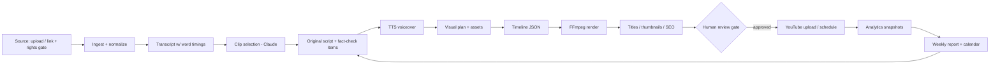

# Architecture

Components
- **web** (Next.js, Vercel): UI + API routes; enqueues jobs, never does heavy media work.
- **worker** (Node + FFmpeg, container): claims jobs from the `jobs` table with `FOR UPDATE SKIP LOCKED`.
- **Neon Postgres**: system of record and queue.
- **Storage**: interface; local disk in dev, object storage in prod.
